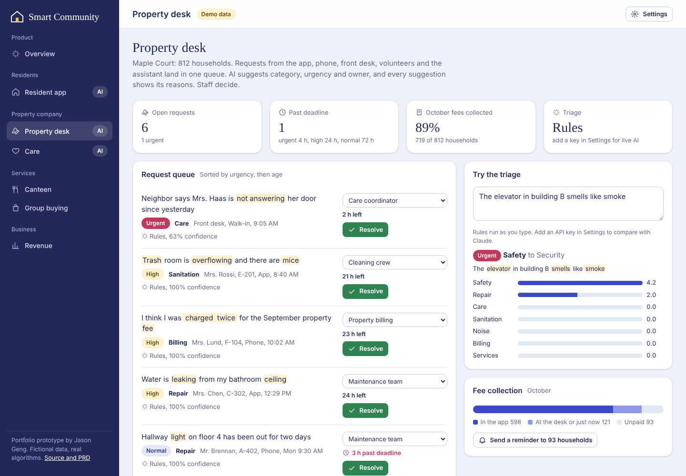

# Smart Community

**One app for an aging neighborhood. Residents order lunch, report problems in their own words, check in and pay bills from a phone built for a 78-year-old. The property desk gets one AI-triaged queue, care staff see who to check on and why, merchants run group buys with a demand forecast, and the platform earns from three kinds of customer.**

▶ **[Open the live prototype](https://jasonmayg.github.io/smart-community/)**. It runs in the browser with no sign-up.

Suggested path: **Resident app** (order lunch, report a leak, press “I’m OK”, ask the assistant) → **Property desk** → **Care** → **Revenue**.

<p align="center">
  
</p>

## Why I built this

I led product for a smart-community platform: property services, a community canteen, elder care and neighborhood group buying. This prototype rebuilds those product ideas from scratch, with fictional data, so they can be shown publicly. Requirements, metrics and risks are in the **[PRD](docs/PRD.md)**; how the code is organized is in **[ARCHITECTURE](docs/ARCHITECTURE.md)**.

The core product decision: **the daily touchpoints are the data.** A lunch order, a door opening, a bill payment and a repair request are each a small, reliable signal. When the property desk, the canteen, care volunteers and merchants share one system, a skipped lunch becomes a wellbeing check, and a sentence typed by a resident reaches the right person without a form.

## What’s in it

| Area | What you can do |
|---|---|
| **Resident app** | Large type, one decision per screen. Order lunch (dine-in or delivery) and pay from the wallet. Report a problem in plain words or by voice. Press “I’m OK” or “I need help”. Hear notices read aloud. Pay the property bill, join group buys, ask a family member to top up. Ask the **assistant** anything; it answers and offers one button to act. |
| **Property desk** | One queue from the app, phone, front desk, volunteers and the assistant. **AI triage** sets category, urgency, owner and a response deadline, with the words that drove it highlighted. Staff can override, and with a key can compare against Claude. Also shows fee collection and reminders. |
| **Care** | A **wellbeing watchlist** scored from missed plan lunches, door-sensor activity against each resident’s own baseline, and missed check-ins. Every point has a sentence behind it, and there is a 14-day signal strip per resident. Staff can send a volunteer, call family, pause a meal plan or dismiss. Volunteers who report “No answer” raise an urgent case automatically. |
| **Canteen** | Today’s orders by source, plus a walk-in forecast for tomorrow that reacts to the weather, with an 80% range from back-testing. Delivery routes are grouped by building and floor. |
| **Group buying** | Live merchant deals. A **forecast of final orders** blends current pace with item history and gives stock advice and the chance of reaching the minimum. Shows settlement with commission. |
| **Revenue** | What the property company, residents and merchants each pay, and where every payment made in the demo was split. |

<p align="center">
  
  
</p>
<p align="center">
  
  
</p>

## The AI, honestly

| Feature | How it works | Real or simulated |
|---|---|---|
| **Request triage** | Transparent cue-weight classifier over 7 categories with urgency rules. Optional live mode sends the text to Claude for category, urgency, a reason and a reply to the resident; both answers are kept so staff see disagreements. | Real code. Requests are fictional. |
| **Community assistant** | Offline mode retrieves from a small community handbook. Live mode grounds Claude in the same handbook and asks for JSON: a reply plus at most one suggested action (order lunch, file a request, open bills, open shop, alert the desk). The resident confirms every action. | Real code. Live mode needs your key. |
| **Wellbeing score** | Named signals with fixed points: missed plan lunches, door activity vs. the resident’s own baseline, missed check-ins, with context (living alone, age) counted only when another signal fired. | Real rules on simulated sensor history |
| **Walk-in forecast** | Recency-weighted same-weekday average × weather factor; range from back-tested error | Real code, simulated history |
| **Group-buy forecast** | Pace estimate (orders ÷ typical share by this point) blended with 8 weeks of history, weighted by time elapsed; stock at the 70th percentile | Real code, simulated history |
| **Voice** | Browser speech recognition for input and speech synthesis for read-aloud, where the browser supports them | Real |

Guardrails are built in. The AI never contacts a resident or acts on its own. Every flag shows why it fired. Wellbeing signals come from routines, not cameras or location.

## Product decisions worth discussing

- **No forms for older residents.** “Report a problem” is one text box or a voice note, and triage does the sorting. The cost of a misroute is a staff click, while the cost of a form is a resident who never reports.
- **Explainable over clever for care.** A score a coordinator can read line by line is trusted and acted on; an opaque risk number is ignored after the first false alarm.
- **The assistant suggests, the resident confirms.** One action button per answer keeps the model useful without letting it act on an 80-year-old’s behalf.
- **Software gets you in, services pay.** The property company pays for the desk, but most revenue comes from what residents and merchants use every day. The Revenue page makes that mix visible.

## Tech

Static site in HTML, CSS and vanilla JavaScript modules, with no build step and no backend. Domain logic (triage, wellbeing, forecasts, ledger, assistant) is DOM-free and covered by unit tests (`npm test`, Node 22) that run in CI. Demo state is saved in the browser (Settings → Reset demo). Live AI is optional; the API key stays in the tab’s memory.

```
assets/js/
  lib/       format, store, ui, icons, llm   (shared helpers)
  domain/    data, triage, wellbeing, forecast, routes, ledger, assistant   (pure, tested)
  views/     overview, resident, desk, care, canteen, market, revenue
  state.js   app state + actions        main.js   shell and router
tests/       node:test suites for domain/
```

## Credits

Designed and built by **Jason Geng**. All people, places, merchants and figures are fictional.

---

© 2026 Jason Geng. All rights reserved. Shared for portfolio review.
