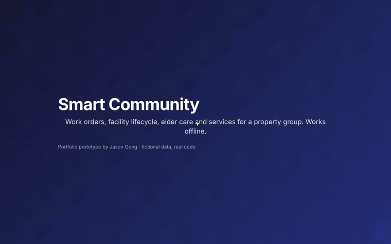
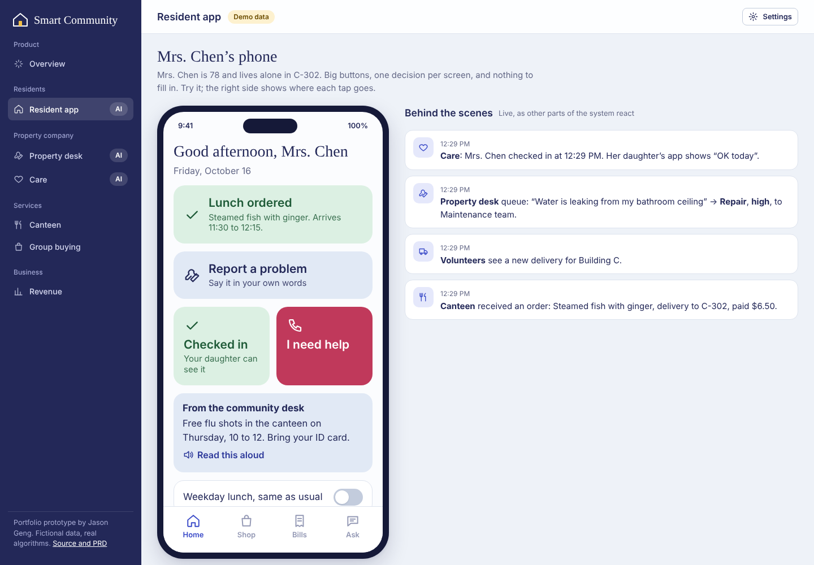
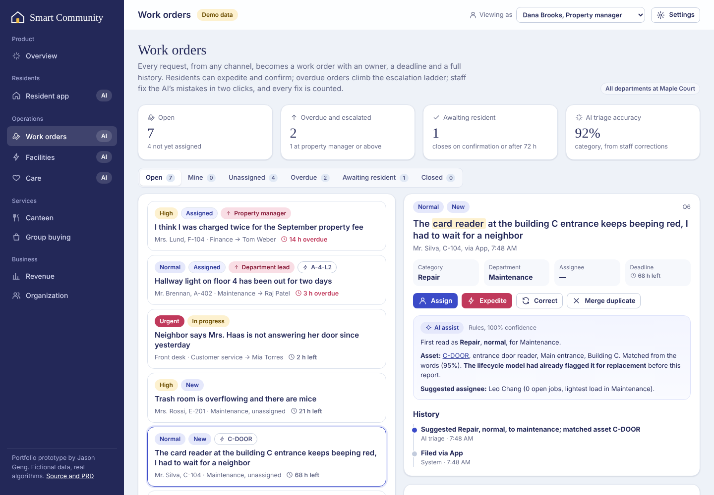
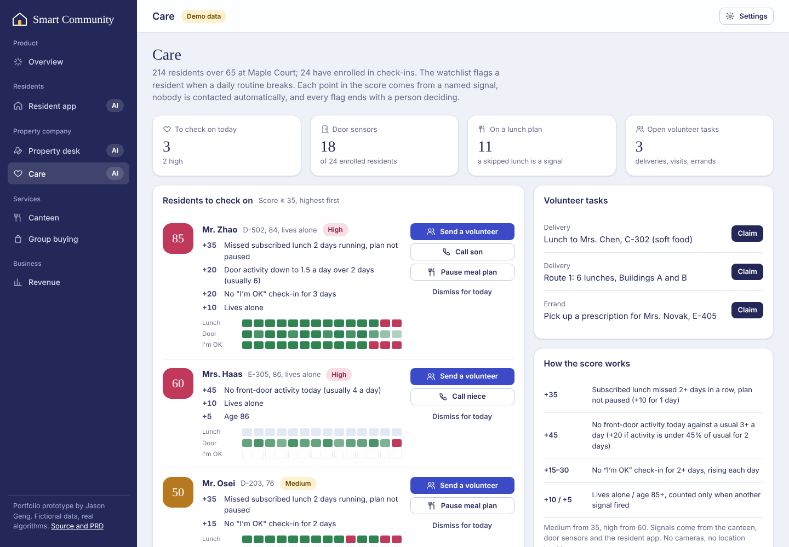
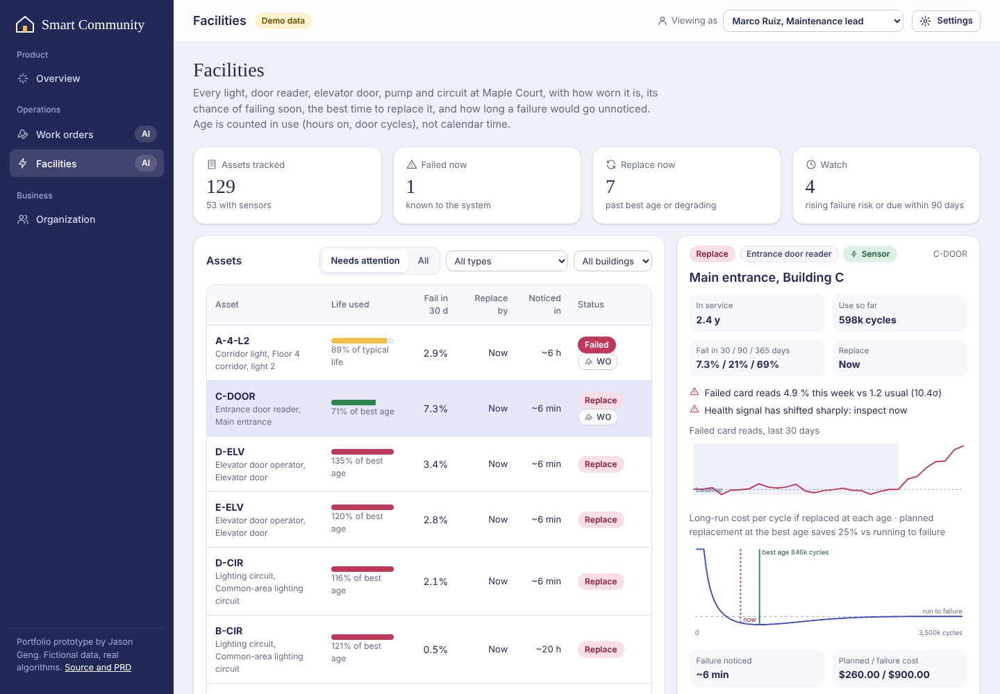
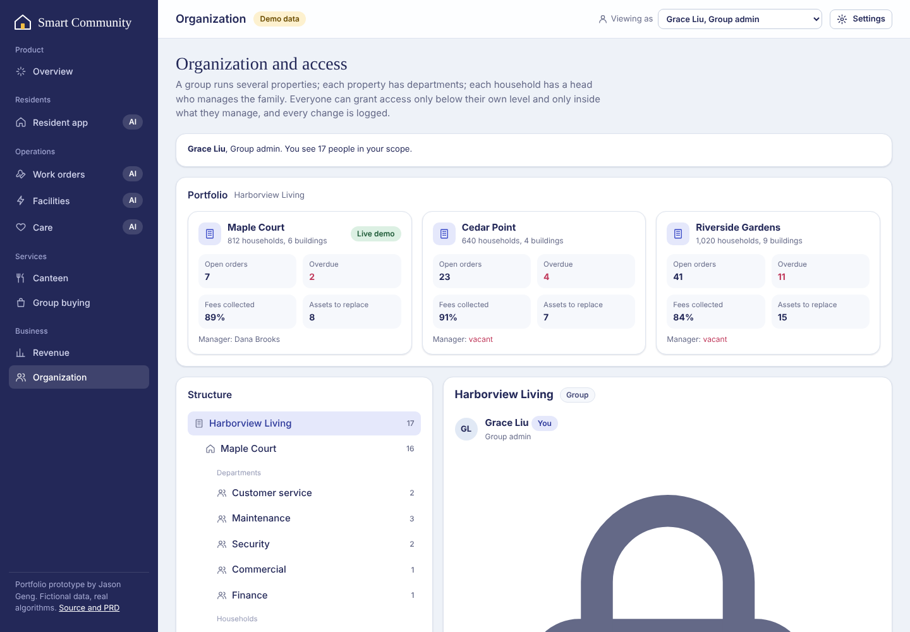
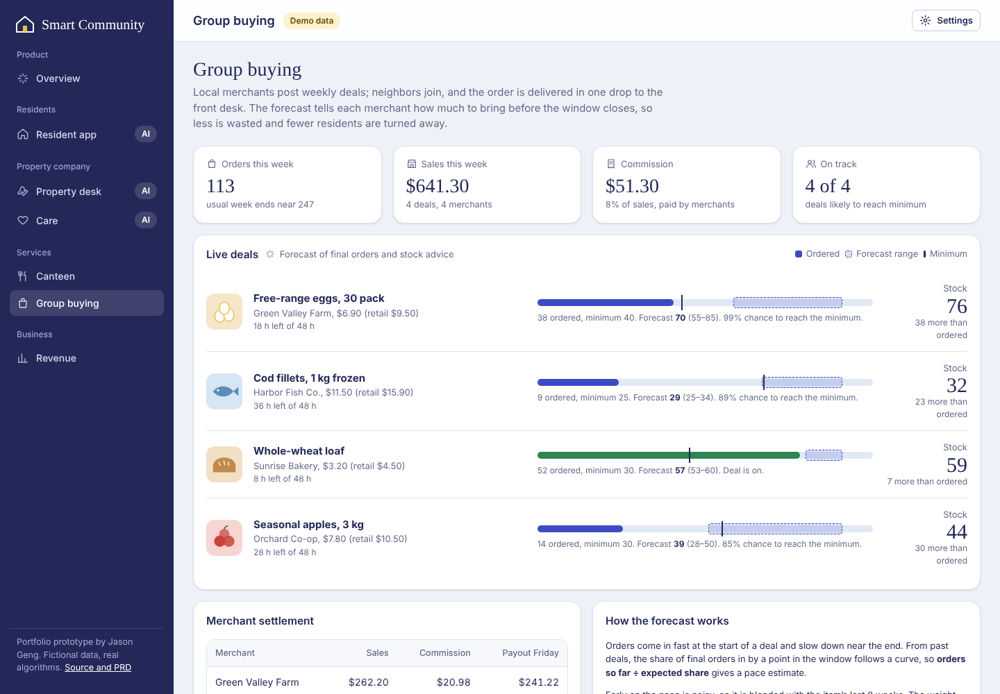
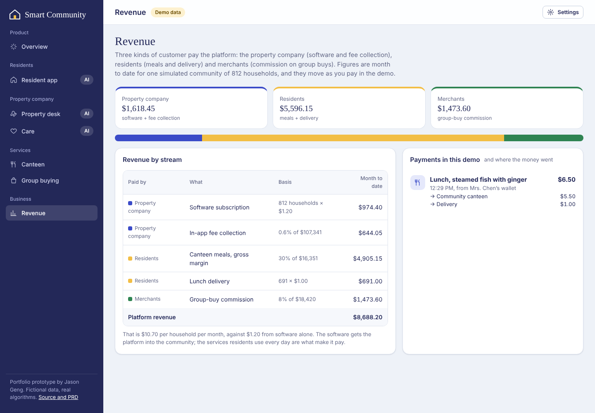

# Smart Community

**One app for a property group and its aging neighborhoods. Residents report problems in their own words from a phone built for a 78-year-old. Every request becomes a tracked work order with escalation and corrections. Every light, door reader and elevator door has a predicted replacement date. Access is delegated level by level, from group to property to department to household.**

▶ **[Open the live prototype](https://jasonmayg.github.io/smart-community/)**. It runs in the browser with no sign-up.

A 60-second guided tour opens on your first visit (replay it from **Tour** at the top). Suggested path: **Resident app** (report a problem, mark it urgent, confirm a fix) → **Work orders** → **Facilities** → **Organization**. Use **Viewing as** at the top to see the product as a group admin, a technician or a household head.

<p align="center">
  <a href="docs/demo.mp4"></a><br>
  <sub>2-minute walkthrough: a resident reports a problem, it becomes a work order, facility lifecycle predictions, delegated access, offline mode. ▶ <a href="docs/demo.mp4">Full video with captions (MP4, 2 min)</a></sub>
</p>

<p align="center">
  
</p>

## Why I built this

I led product for a smart-community platform: property services, a community canteen, elder care and neighborhood group buying. This prototype rebuilds those product ideas from scratch, with fictional data, so they can be shown publicly. Requirements, metrics and risks are in the **[PRD](docs/PRD.md)**; how the code is organized is in **[ARCHITECTURE](docs/ARCHITECTURE.md)**.

The core product decision: **the daily touchpoints are the data.** A lunch order, a door opening, a bill payment and a repair request are each a small, reliable signal. When the property desk, the canteen, care volunteers and merchants share one system, a skipped lunch becomes a wellbeing check, and a sentence typed by a resident reaches the right person without a form.

## What’s in it

| Area | What you can do |
|---|---|
| **Resident app** | Large type, one decision per screen. Order lunch (dine-in or delivery) and pay from the wallet. Report a problem in plain words or by voice. Press “I’m OK” or “I need help”. Hear notices read aloud. Pay the property bill, join group buys, ask a family member to top up. Ask the **assistant** anything; it answers and offers one button to act. |
| **Work orders** | One queue from the app, phone, front desk, volunteers, the assistant and the facility model. Lifecycle: new → assigned → in progress → on hold → done → resident confirms (or reopens). Residents can **expedite** once; staff can raise urgency further. Overdue orders climb an **escalation ladder** (department lead → property manager → group). Staff **correct** category, department, urgency or asset with a reason, and **merge duplicates**. Every step lands in a timeline. |
| **Triage evaluation** (AI) | 78 labeled resident requests, written the way residents write (25 built to be hard: danger described calmly, two problems at once, a prowler who never "breaks in"). Scores the rules on the right team, urgency, **urgent requests caught** and help needed but marked lower, with a confusion matrix and every miss. With your own API key, runs the same set on the live model and on rules + model side by side, with tokens and latency. The finding that matters: the keyword rules catch only 9 of 16 urgent requests, which is why urgency can only go up and urgent recall is the release bar. |
| **Facilities** | 129 lights, door readers, elevator doors, pumps and circuits. For each one: life used (counted in hours on or door cycles), chance of failing in 30, 90 and 365 days, the best age to replace it, and how long a failure goes unnoticed (minutes with a sensor, hours or days without). The page also shows replacement visits batched by building and an AI maintenance plan. |
| **Organization** | Group → properties → departments (customer service, maintenance, security, commercial, finance) → staff, plus households → head, adults, older adults, children. Each level grants access only **below itself and inside its own scope**, and every grant is logged. The page has a portfolio view for the group and a permission matrix. |
| **Care** | A **wellbeing watchlist** scored from missed plan lunches, door-sensor activity against each resident’s own baseline, and missed check-ins. Every point has a sentence behind it, and there is a 14-day signal strip per resident. Staff can send a volunteer, call family, pause a meal plan or dismiss. Volunteers who report “No answer” raise an urgent case automatically. |
| **Canteen** | Today’s orders by source, plus a walk-in forecast for tomorrow that reacts to the weather, with an 80% range from back-testing. Delivery routes are grouped by building and floor. |
| **Group buying** | Live merchant deals. A **forecast of final orders** blends current pace with item history and gives stock advice and the chance of reaching the minimum. Shows settlement with commission. |
| **Revenue** | What the property company, residents and merchants each pay, and where every payment made in the demo was split. |

<p align="center">
  
  
</p>
<p align="center">
  
  
</p>
<p align="center">
  
  
</p>

## Works offline

Technicians work in pump rooms and elevator shafts; older residents are often on weak connections. The app installs as a PWA and **opens and runs with no network**. Work-order changes made offline are queued on the device as operations and **replayed on reconnect**: unchanged orders fast-forward, compatible changes merge, and contradictions (for example, the job was reassigned at the desk meanwhile) go to a person to review, with the decision written to the history. Payments pause offline, and the help button falls back to one-tap phone calls. Design notes: **[OFFLINE](docs/OFFLINE.md)**.

## The AI, honestly

| Feature | How it works | Real or simulated |
|---|---|---|
| **Request triage** | Transparent cue-weight classifier over 7 categories with urgency rules. Optional live mode sends the text to Claude for category, urgency, a reason and a reply to the resident; both answers are kept so staff see disagreements. | Real code. Requests are fictional. |
| **Triage evaluation** | Labeled set, scoring (category, urgency, under-calls, urgent recall, confusion matrix), optional live-model run with token and latency tracking; unit-tested | Real scoring code; fictional requests and labels |
| **Facility lifecycle** | Weibull life per asset type over usage; conditional failure probability given age; best replacement age from the age-replacement cost model (planned swap vs failure cost); each asset’s health signal compared with its own baseline. Types where planned replacement saves under 10% are run to failure, and for those the value is in detecting failures fast. | Real code. Asset ages and signals are simulated. |
| **Work-order assist** | Matches a resident’s words to the asset they mean (building, floor, type), flags when the lifecycle model had already predicted it, suggests the least-loaded assignee and finds likely duplicates. Triage accuracy is measured from staff corrections. | Real code |
| **AI maintenance plan** | Offline mode writes a plan from the model outputs. Live mode asks Claude for a 3 to 5 step plan grounded in the same asset data. | Real code. Live mode is optional. |
| **Community assistant** | Offline mode retrieves from a small community handbook. Live mode grounds Claude in the same handbook and asks for JSON: a reply plus at most one suggested action (order lunch, file a request, open bills, open shop, alert the desk). The resident confirms every action. | Real code. Live mode needs your key. |
| **Wellbeing score** | Named signals with fixed points: missed plan lunches, door activity vs. the resident’s own baseline, missed check-ins, with context (living alone, age) counted only when another signal fired. | Real rules on simulated sensor history |
| **Walk-in forecast** | Recency-weighted same-weekday average × weather factor; range from back-tested error | Real code, simulated history |
| **Group-buy forecast** | Pace estimate (orders ÷ typical share by this point) blended with 8 weeks of history, weighted by time elapsed; stock at the 70th percentile | Real code, simulated history |
| **Voice** | Browser speech recognition for input and speech synthesis for read-aloud, where the browser supports them | Real |

Guardrails are built in. The AI never contacts a resident or acts on its own. Every flag shows why it fired. Wellbeing signals come from routines, not cameras or location.

## Product decisions worth discussing

- **No forms for older residents.** “Report a problem” is one text box or a voice note, and triage does the sorting. The cost of a misroute is a staff click, while the cost of a form is a resident who never reports.
- **Explainable over clever for care.** A score a coordinator can read line by line is trusted and acted on; an opaque risk number is ignored after the first false alarm.
- **The assistant suggests, the resident confirms.** One action button per answer keeps the model useful without letting it act on an 80-year-old’s behalf.
- **Count the AI’s mistakes from real work.** Corrections are structured (field, from, to, reason), so “category right first time” is measured, not guessed. Auto-assignment should be unlocked only above a set accuracy.
- **Not every asset deserves planned replacement.** For corridor lights, replacing early saves about 6%, so the right move is run to failure plus sensors. For elevator doors and readers, a planned swap saves 25 to 29%.
- **Delegation mirrors the real organization.** A group admin can’t be created by a property manager, and a household head can add a child but not a technician. Least privilege is built into the model, not left to configuration.
- **Software gets you in, services pay.** The property company pays for the desk, but most revenue comes from what residents and merchants use every day. The Revenue page makes that mix visible.

## Tech

Static site in HTML, CSS and vanilla JavaScript modules, with no build step and no backend. Domain logic (triage, work orders, facility lifecycle, access control, wellbeing, forecasts, ledger, assistant) is DOM-free and covered by 40 unit tests (`npm test`, Node 22) that run in CI. Demo state is saved in the browser (Settings → Reset demo). Live AI is optional; the API key stays in the tab’s memory.

```
assets/js/
  lib/       format, store, ui, icons, llm   (shared helpers)
  domain/    data, triage, workorders, sync, assets, org, wellbeing, forecast, routes, ledger, assistant   (pure, tested)
  views/     overview, resident, orders, facilities, care, canteen, market, revenue, org
  state.js   app state + actions        main.js   shell and router
tests/       node:test suites for domain/
```

## Credits

Designed and built by **Jason Geng**. All people, places, merchants and figures are fictional.

---

© 2026 Jason Geng. All rights reserved. Shared for portfolio review.
