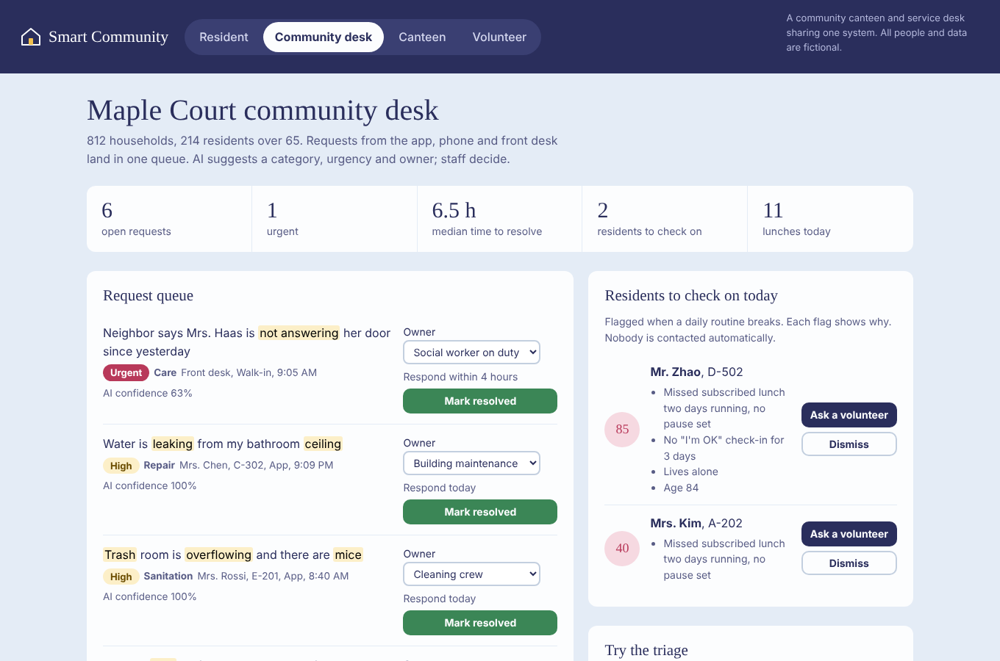
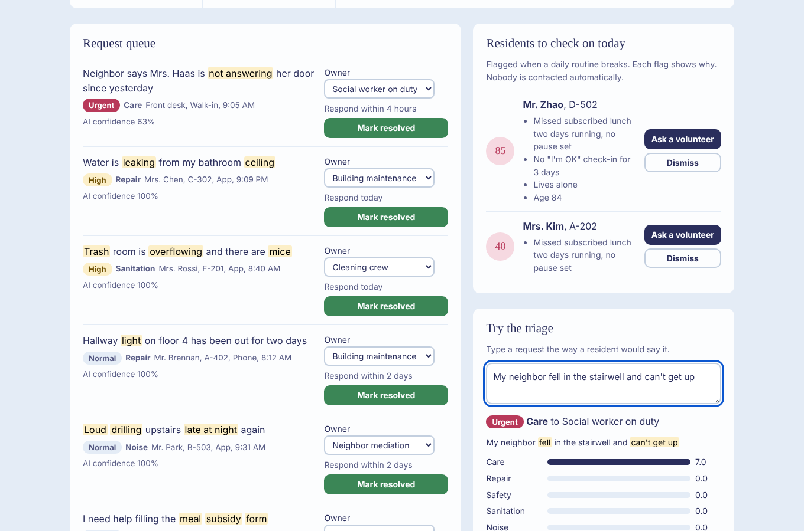
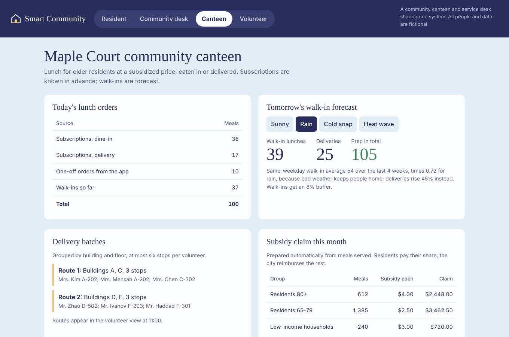

# Smart Community

**A community canteen and service desk that share one system — so a missed lunch becomes a wellbeing signal, and a 78-year-old can order a meal or report a leak in three taps.**

▶ **[Try the live demo](https://jasonmayg.github.io/smart-community/)** — runs in the browser, no sign-up. Start on Mrs. Chen's phone and watch where each tap goes.

  

## Why I built this

I worked on community-canteen and resident-services products for aging neighborhoods. This demo rebuilds the core ideas from scratch, with fictional data. The full product thinking is in the **[PRD](docs/PRD.md)**.

Two observations shaped it:

1. **The daily meal is the most reliable touchpoint with an older resident.** If the canteen and the service desk share data, a subscribed lunch that's skipped two days in a row is a reason to knock on a door, not just lost revenue.
2. **The hardest user is the one who doesn't use apps.** The resident screen has three large actions and plain language, and requests can be typed the way people talk — no forms, no categories to pick.

## What you can do in the demo

| View | Try this | What it shows |
|---|---|---|
| **Resident** | Order lunch for delivery, report "water is leaking from my ceiling", press "I'm OK today" | Three-tap ordering, subsidized pricing, free-text reporting, daily check-in; the side panel shows where each action lands |
| **Community desk** | Look at the queue and the "residents to check on" list; type your own request into the triage box | AI triage with highlighted cues and confidence, owner override, wellbeing flags with reasons, one click to send a volunteer |
| **Canteen** | Switch tomorrow's weather to rain | Walk-in forecast, delivery routes by building, automatic subsidy claim |
| **Volunteer** | Claim a task, mark it done with "No answer" | Volunteer work flows back to the desk as a follow-up |

  

## The algorithms (real code, simulated data)

| Feature | Decision it changes | How it works |
|---|---|---|
| **Request triage** | Who handles a request, and how fast | Weighted phrase scoring across six categories, safety override, urgency rules ("gas", "fell", "not answering" → urgent); matched cues are highlighted so staff can see why |
| **Wellbeing flags** | Who gets a check-in today | Rules on routine breaks: missed subscribed lunches with no pause, missing "I'm OK" check-ins, drop vs. usual orders; extra weight for living alone and age 80+; every flag lists its reasons |
| **Walk-in forecast** | How much to cook | Same-weekday average over four weeks × weather factor; deliveries rise when walk-ins fall |
| **Delivery batching** | Volunteer routes | Group by building and floor, at most six stops per route |

**Guardrails by design:** the AI never contacts a resident on its own, staff can override every suggestion, flags can be dismissed and expire daily, and wellbeing data stays with the community desk.

  
  

## What I'd measure in production

Weekly meal reach among residents 65+, taps to order, time to resolve (urgent < 4h), share of AI categories accepted without change, flagged residents checked within 24h, and food waste. Targets are in the [PRD](docs/PRD.md#6-success-metrics-what-i-would-measure-in-production).

## Tech

One HTML file: vanilla JavaScript and CSS. No build step, no dependencies, no backend; nothing you type leaves the browser. "Read this aloud" uses the browser's built-in speech.

## Credits

Designed and built by **Jason Geng**. All residents, buildings and figures are fictional.

---

© 2026 Jason Geng. All rights reserved. Shared for portfolio review.
